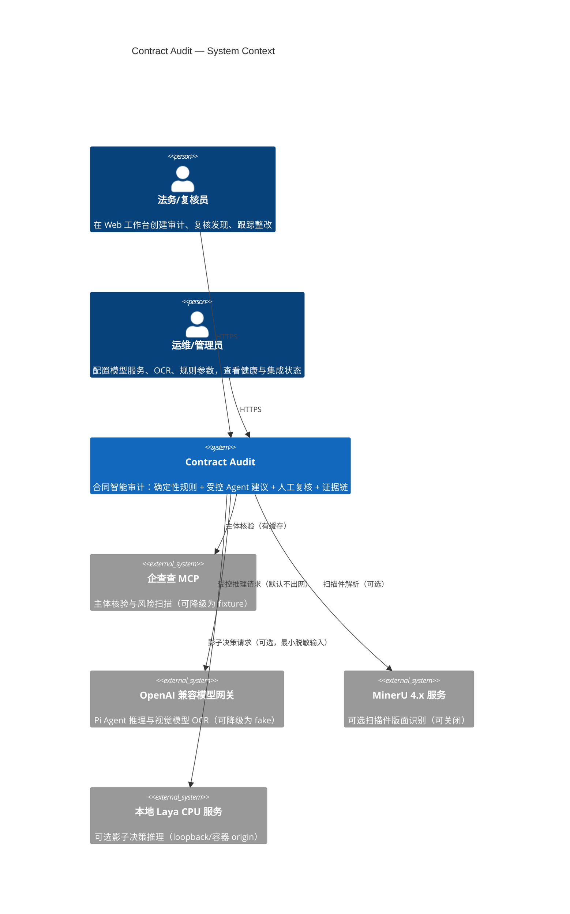
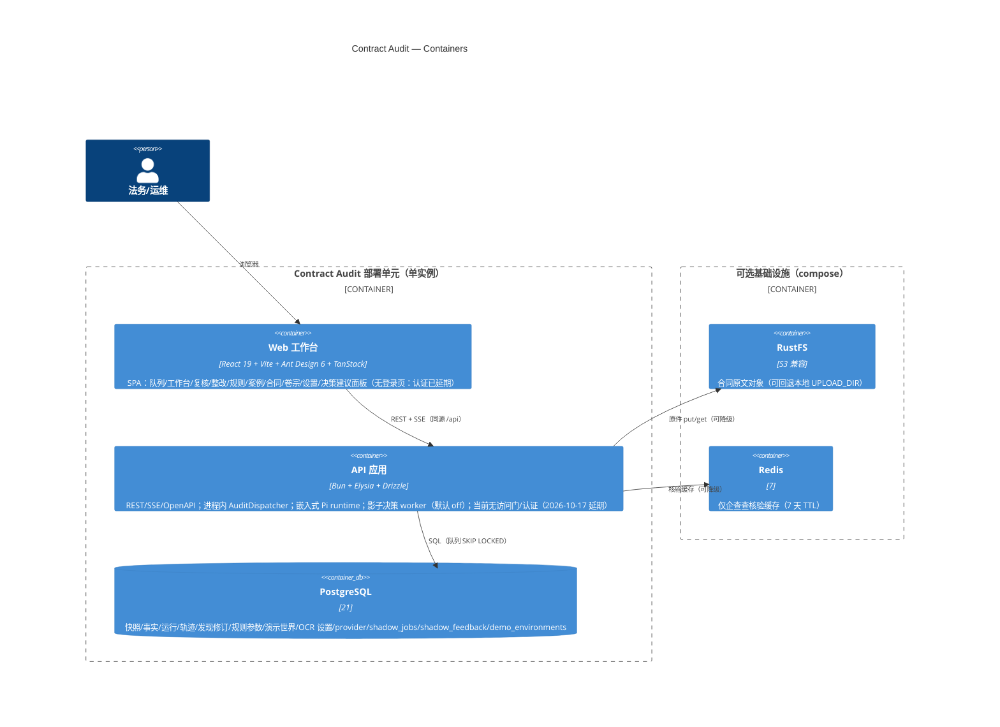
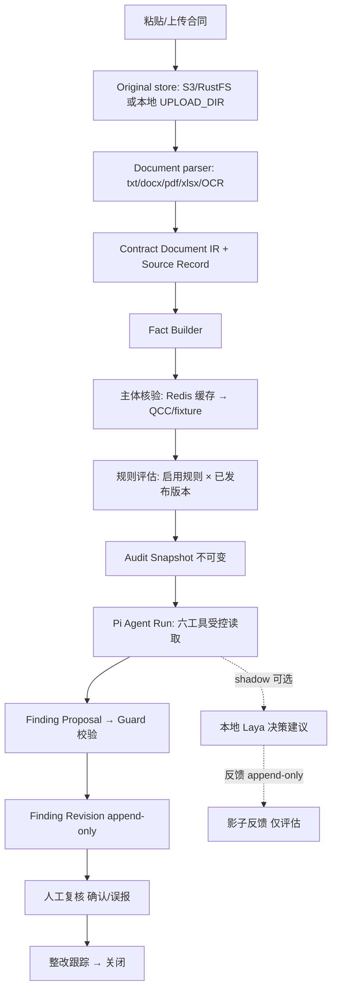

# C4 架构视图与 ADR 索引（R2）

> 维护人：Agent 5（Docs）。基准日：2026-10-15。本文是 C4 Context/Container 层的**当前实现视图**；Component 层按模块边界说明，不为图示重绘代码细节。
> 既有权威文档：`docs/architecture/mvp.md`（架构总览）、`docs/adr/`（决策记录）。本文不复制其结论，只做索引与图形化。

## 1. Context（系统上下文）

外部依赖的降级语义：qcc/llm/mineru/laya 全部可在缺失时保持正式审计流程（fake 模式、OCR 关闭、影子 off）；**只有 PostgreSQL 与进程内 dispatcher 是硬依赖**（health 503 仅由二者驱动）。

## 2. Container（容器/进程视图）

部署形态：`compose.yaml` 一条定义覆盖开发（基础设施容器化、应用宿主运行）与演示（整套栈容器化，API 自迁移，`AUDIT_AGENT_MODE` 默认 fake）。**没有**多副本、外部消息队列或独立 Pi 服务。

## 3. Component（模块边界，与代码一致）

| 模块 | 路径 | 职责 | 明确不承担 |
| --- | --- | --- | --- |
| 领域核心 | `packages/audit` | Contract Document IR、Fact Builder、19 条规则、Contract Stance、Proposal Guard、编排端口、决策契约 | HTTP/PG/Pi/React 依赖 |
| Agent 适配 | `packages/pi-agent` | Pi 1.2.0 会话、六工具白名单、指令与资源隔离、轨迹上报 | 修改规则结论、直接访问数据库 |
| 应用组合 | `apps/api` | 路由、DTO、仓库、dispatcher、SSE、原件存储适配、provider/OCR 解析、出网策略、跨站写入拒绝 | 领域判断。**不承担**认证（登录/Bearer/session 已于 2026-10-17 延期） |
| 前端 | `apps/web` | 工作台与治理页面（Eden Treaty + EventSource） | 直连数据库/对象存储 |
| 演示数据 | `packages/audit/src/demo-scenarios.ts`、`apps/api/src/demo/` | 固定 RNG 场景化种子与重置 | 生产数据清理 |

## 4. 关键数据流

## 5. ADR 索引

| ADR | 决策 | 状态 |
| --- | --- | --- |
| [0001](../adr/0001-bun-modular-monolith-with-embedded-pi.md) | Bun 模块化单体 + 嵌入式 Pi | accepted |
| [0002](../adr/0002-evidence-anchors-beyond-the-contract-document.md) | 证据锚定超越合同文档 | accepted |
| [0003](../adr/0003-rule-parameters-versioned-not-rule-logic.md) | 版本化规则参数而非规则逻辑 | accepted |
| [0004](../adr/0004-nested-tool-calls-in-the-agent-trace.md) | 轨迹记录嵌套工具调用为观察到的父链接 | accepted |
| [0005](../adr/0005-turn-boundaries-in-the-agent-trace.md) | 轮次边界来自 Pi 事件而非 UI 推导 | accepted |

计划新增（S3 前，未写则不宣称存在）：影子任务独立队列 ADR、演示环境保护 ADR、存储契约 ADR。S2 已交付的影子持久化/worker/决策 UI 与受管演示 CLI 按代码为准（`a6ec041`、`908cb5a`、`cc942b2`、`f7ce8d1`）；对应 ADR 补录在 S3 文档定稿窗口。

## 6. 规范采用记录（适用场景 → 本项目做法 → 验收证据）

| 规范 | 适用场景 | 本项目做法 | 验收证据 |
| --- | --- | --- | --- |
| arc42 | 文档组织结构 | 采用其"约束/构建块/质量"分层组织 engineering 文档 | `docs/engineering/` 各文件 |
| C4 Model | 架构沟通 | Context/Container 用 Mermaid 固化，Component 以表格对齐代码路径 | 本文 §1–§3 与 `docs/architecture/mvp.md` |
| ADR（MADR 风格） | 决策留痕 | 每条 ADR 含选项、上下文、后果；新决策先写 ADR 再改码 | `docs/adr/` |
| ISO/IEC 25010:2023 | 质量属性语言 | NFR 按功能适合性/可靠性/可维护性/安全/可移植性分组，**不宣称通过认证** | `docs/engineering/requirements.md` §3 |
| NIST AI RMF | AI 治理框架 | 借用"测量/管理/映射"思路组织影子治理与 KPI，**不宣称合规** | `docs/competition/METRICS.md` |
| OWASP Top 10 for LLM Apps 2025 | 威胁清单 | 用于 SEC-04/05/08 的检查项，不作认证声明 | `docs/engineering/requirements.md` §4 |
| Twelve-Factor | 配置管理 | 配置经环境变量注入；密钥不进 Git；`.env` 不入库 | `.env.example`、`.gitignore` |
