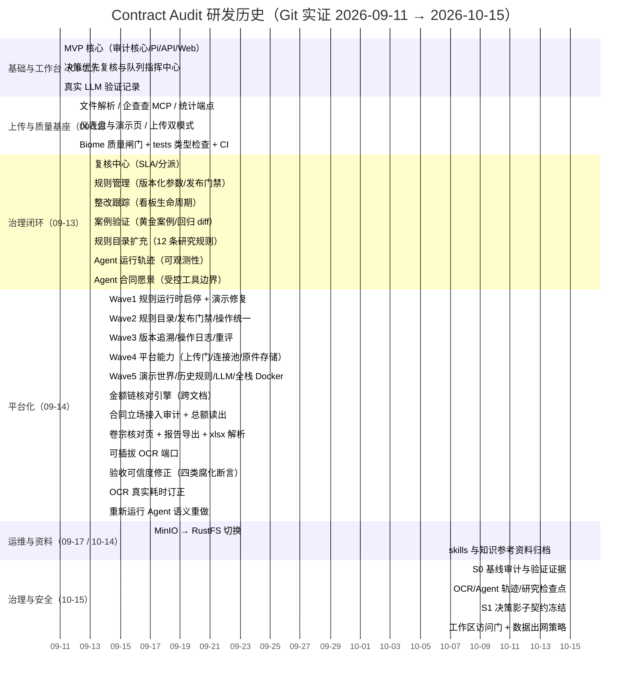
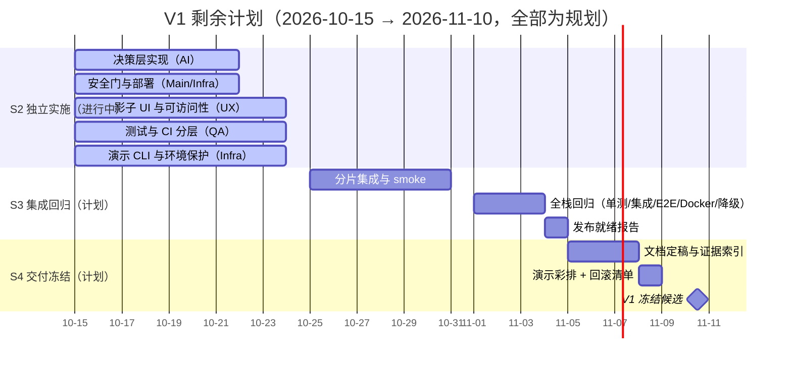

# 研发历史、里程碑与甘特图（R1）

> 维护人：Agent 5（Docs）。事实基准日：2026-10-15。V1 目标：2026-11-10。
> **纪律**：历史段落全部由 `git log` 重建，每个节点附真实 commit SHA；未来段落全部为**计划**，不得当作已完成事实。凡 Git 不能证明的活动一律标"待核验/缺乏证据"。

## 0. 口径与证据边界

- 历史来源命令（可复跑）：
  ```bash
  git rev-parse HEAD
  git log --all --date=short --since=2026-09-11 --format='%h %ad %s'
  ```
- 本仓库历史起点为 `2cee58a`（2026-09-11），**非浅克隆**（`git rev-parse --is-shallow-repository` 为 `false`，见 S0 基线）。共 100 个可达提交，日期分布：09-11 ×17、09-12 ×7、09-13 ×34、09-14 ×35、09-17 ×1、10-14 ×2、10-15 ×4。
- **限制**：Git 只证明"提交何时发生、包含什么变更"，不能反推每项需求的实际起止、工时或完成率。9-11 至 9-14 的高度集中说明那是主要产出窗口；10-15 的四个提交是 S0/S1/S2 的治理与安全切片，**不代表 10-15 单日完成了全部系统**。
- 提交密度不等于完成度：09-13/09-14 的大量提交中包含 style、test、fix 与 merge 提交，功能里程碑按下表的关键 SHA 判定。

## 1. 历史已完成（Git 实证）

### 1.1 阶段总览（Mermaid Gantt）



### 1.2 关键里程碑与 SHA 证据

| # | 日期 | 里程碑 | 关键 commit | 主题（git log 原文） |
| --- | --- | --- | --- | --- |
| M1 | 09-11 | 系统起点：审计核心 + Pi Agent + API + Web 工作台 | `2cee58a` | feat: Contract Audit MVP — audit core, Pi agent, API, web workbench |
| M2 | 09-11 | 决策优先复核工作台与队列指挥中心 | `2f0e559` / `f7ac822` | feat: build decision-first audit review / audit queue command center |
| M3 | 09-11 | 真实 LLM 冒烟验证入档 | `c214e71` | docs: record real-LLM verification |
| M4 | 09-12 | 上传解析（docx/pdf/xlsx）+ 企查查 MCP + 统计 | `ce79ed7` | feat(api): 文件上传解析、企查查 MCP adapter 与统计端点 |
| M5 | 09-12 | 合同文档 IR + 四条确定性规则 + golden 回归 | `50331dd` | feat(audit): 合同文档 IR、四条确定性规则与 golden set 回归 |
| M6 | 09-12 | Biome 质量闸门 + tests 类型检查 + CI | `433effb` | chore(quality): 引入 Biome 质量闸门、tests 类型检查与 CI |
| M7 | 09-13 | 复核中心（SLA 队列 / 批量转交） | `fcad4ae` | feat: review center — per-finding review queue with SLA and assignment |
| M8 | 09-13 | 规则管理（参数版本化、发布门禁） | `25322d6` | feat: rule management — versioned params, golden validation gate, publish flow |
| M9 | 09-13 | 整改跟踪（自动创建 / 看板生命周期） | `653a3d6` | feat: remediation tracking — auto-created items, kanban lifecycle, reviewer close |
| M10 | 09-13 | 案例验证（黄金案例 / 回归 diff） | `0d7ec42` | feat: case validation — materialized golden cases, run history, regression diff |
| M11 | 09-13 | 规则目录扩充至采购风险规则 | `9ce72b8` | feat: expand deterministic rule catalogue — 6+ researched procurement risk rules |
| M12 | 09-13 | Agent 运行轨迹（全可观测） | `7dd0a82` | feat: agent run traces — full observability for the Pi Agent |
| M13 | 09-13 | Agent 受控工具边界（六工具 + 代码强制的提交边界） | `f525af2` / `11c5cf9` | merge/feat: agent contract vision — search/read tools + code-enforced submission boundary |
| M14 | 09-14 | Wave1–Wave5 平台化（规则启停 → 演示世界 → 全栈 Docker） | `fa345dc`…`431e1d0` | feat: Wave N — … |
| M15 | 09-14 | 跨文档金额链核对引擎 | `8b7a8fa` | feat(audit): 跨文档金额链核对引擎 |
| M16 | 09-14 | 合同立场接入真实审计 + 载明总额读出 | `bf14a2b` / `46fefa7` | feat(api/api-audit): 卷宗金额链核对端点… / 读出合同载明总额… |
| M17 | 09-14 | 可插拔 OCR 端口（vlm 实现） | `6ef86cc` | feat(api): read scanned contracts through a pluggable OCR port |
| M18 | 09-14 | xlsx 解析（保留单元格地址与公式） | `e7a8545` | feat(api): parse .xlsx, keeping cell addresses and formulas |
| M19 | 09-14 | 重新审计语义（新案 / 旧案保留） | `c260e4b` | feat: 重新运行 Agent 分析并保留复核与整改记录 |
| M20 | 09-17 | RustFS 替换 MinIO | `1c1dc7b` | chore: replace MinIO with RustFS |
| M21 | 10-14 | skills / 知识参考资料归档 | `5523e9d` | docs: collect contract audit skills and knowledge references |
| M22 | 10-15 | S0 基线审计（含实测 652/0、37/38 E2E） | `a4c6119` | docs: record S0 baseline audit and verification evidence |
| M23 | 10-15 | S1 影子决策契约冻结（18 测试通过） | `6a59906` | feat(decision): freeze versioned local Laya shadow contracts |
| M24 | 10-15 | 工作区访问门 + 出网策略 + 操作者校验 | `1f33d99` | feat(security): gate workspace access and contract model data |
| M25 | 10-15 | 密钥轮换/重封 + 真实模型/缓存证据 | `cd24aac`/`2d63f15`/`b2033e1` | feat/fix(security): rotate stored keys / redact failure logs / revoke active streams |
| M26 | 10-15 | S2 决策影子实现（provider/持久化/worker/路由） | `a6ec041`、`f7ce8d1` | feat(agent): add isolated persistent shadow decisions; feat(db): persist shadow decisions |
| M27 | 10-15 | S2 部署与演示环境保护（digest 固定、localhost、受管 CLI、存储边界） | `908cb5a` | feat(infra): guard demo rebuilds and verify original integrity |
| M28 | 10-15 | S2 决策 UI + 访问会话 + 行为验收（含 375px 修复） | `cc942b2` | feat(web): add access sessions and shadow decision workflow |
| M29 | 10-15 | S2 分层测试/覆盖率/机器报告 + 工程竞赛文档 | `de7ea2d`、`31bb8d1` | test(qa): add layered suites; docs(competition): add engineering and submission evidence |
| M30 | 10-15 | S2 集成修正（reset 删除范围、lint）；检查点 verify 835/0 | `a849b29` | fix(integration): correct demo reset deletes and lint regressions |

### 1.3 测试/质量证据随历史的位置（避免"文档先行"误读）

- 09-14 `a79597e`：修四类腐化断言，使本机验收可信（此后 E2E 数字才有意义）。
- 09-14 `bc5d750`：把视觉模型 OCR 真实耗时 396 秒入档，纠正 17 秒的旧口径。
- 09-14 `5294847`：订正 README 与调研口径，竞品结论入档。
- 10-15 `a4c6119` 附 `docs/project-management/evidence/s1-verification.json`：独立库 670 测试通过、0 失败；18 项决策契约测试通过。
- 10-15 `1f33d99` 附 `docs/project-management/evidence/s2-security.json`：688 测试通过，HTTP 层匿名 401 / 授权 200 / 登出 204 / 重放 401 实测。
- 10-15 S2 五切片合并（M26–M29）：决策影子实现、演示环境保护、决策 UI 与行为验收、分层测试与文档。集成修正 `a849b29` 后 Main 观察 `bun run verify` **835 通过/0 失败**（集成检查点；其后有未提交决策契约修订，最终统一计数以 S3 为准，不与上述各 commit 数字合并）。

## 2. 架构演进（随提交可证）

| 阶段 | 变化 | 证据 |
| --- | --- | --- |
| 09-11 → 09-12 | 从"文本粘贴"扩展到"文件上传 + 外部主体核验 + 统计"；规则从 4 条起步 | `2cee58a`→`ce79ed7`、`50331dd` |
| 09-13 | 引入治理面：规则参数版本化、复核中心、整改、案例验证、Agent 轨迹 | M7–M12 |
| 09-14 | 引入平台面：规则运行时启停、版本追溯、演示世界、LLM provider 管理、全栈 Docker、合同与修订台账、金额链、OCR 端口 | Wave1–Wave5 提交链 |
| 09-17 | 对象存储从 MinIO 切到 RustFS（配置与适配层，领域语义不变） | `1c1dc7b` |
| 10-14 | Pi SDK 0.85.1 → 1.2.0，工具 schema 统一 TypeBox 1.3.27，原生工具计时 | `docs/research/2026-10-14-pi-1.2-upgrade.md`（对应 `d9a84a4` 前的升级链） |
| 10-15 | 决策影子层契约（DecisionRequest/Advice/Feedback，TypeBox 校验）与工作区访问门 | `6a59906`、`1f33d99` |

**未决/待核验项**（不得写成已演进完成）：影子持久化/worker/UI 代码已合并（`a6ec041`、`f7ce8d1`、`cc942b2`，含 `a849b29` 后未提交契约修订待 Main 收尾），但 off/shadow 对照与真实 PG 回归未跑（S3，Main/QA 负责）；本地 Laya 的完整数据集评测（Main 负责，S3）；多副本部署（明确不做，见 FAQ）。

## 3. 未来计划（规划，不是历史）

目标：2026-11-10 V1 冻结。以下日期为计划，附 Owner 与验收；每条在完成前都不得称为事实。
**S2 计划行（P1–P5）的实现已随五份切片合并**（见 §1.2 M26–M30），状态为"已实现待统一验收"；P6 起的统一回归仍全部为规划。`gantt.csv` 同步（`merged-pending-acceptance`）。



| ID | 计划窗口 | 内容 | Owner | 验收（可判定） |
| --- | --- | --- | --- | --- |
| P1 | 10-15 → 10-22 | 决策层：provider（disabled/fake/laya-cpu）、独立 shadow 任务、冻结身份、反馈与详情 DTO | AI | off/shadow 同输入正式结论一致；影子故障不污染成功 case |
| P2 | 10-15 → 10-22 | ~~访问门全 API 覆盖（含 SSE/originals）~~、`LLM_INTERNAL_DATA_ORIGINS` 默认空、compose 转发。**访问门部分已于 2026-10-17 用户指示延期到最后实现**：当前无登录/Bearer/session 强制、无 `/api/session`；重新排期前该行只保留出网策略与 compose 转发验收 | Main + Infra | 匿名 401、授权 200 实测**已作废（延期）**；默认不出网策略有证据（仍有效） |
| P3 | 10-15 → 10-24 | 影子建议展示、未校准标识、反馈入口、375px 复核可达 | UX | 浏览器实测三档宽度；空/off/失败/未校准可区分 |
| P4 | 10-15 → 10-24 | RTM/覆盖率/真实 PG/Redis/S3 回归、失败注入 | QA | 报告含 SHA/退出码；不可测项标 BLOCKED |
| P5 | 10-15 → 10-24 | `scripts/demo/cli.ts`（up/down/reset/seed/verify/check + demo profile `ready`；`logs`/`status`由 Infra 收尾后登记）+ demo 环境保护 | Infra | 两次 reset 结果一致，非 demo 哨兵保留 |
| P5a | 10-15 → 10-24 | 全站视觉重设计（用户新增）：企业SaaS浅色方向，CSS tokens与Ant主题对齐，中文UI/路由/真实API数据不变，无新UI框架/外部字体/GSAP/图标依赖 | VisualRedesign | 四档视口 375/1280/1440/1920 + 键盘操作 Playwright 通过并留存截图；375px 面板控制不回退；reduced motion/焦点可见 |
| P6 | 10-25 → 10-31 | 分片合并、迁移执行、逐切片 smoke | Main | 每切片有集成提交与 smoke 记录 |
| P7 | 11-01 → 11-04 | 统一 verify、集成、E2E、Docker、降级与幂等 | Main + QA | `docs/quality/RELEASE-READINESS.md` 实际数字 |
| P8 | 11-04 → 11-05 | 发布就绪报告与门禁裁决 | Main | P0/P1 全绿或明确 blocked 项 |
| P9 | 11-05 → 11-08 | 文档定稿：README/架构/竞品/演示/FAQ/KPI 与证据索引 | Docs | 每条声明有链接或 SHA |
| P10 | 11-08 → 11-09 | 演示彩排（3/5/8 分钟）与回滚清单 | Docs + Main | 彩排记录；回滚步骤可执行 |
| P11 | 11-10 | V1 冻结候选；是否打 tag 需用户授权 | Main | 冻结清单与遗留分级 |

## 4. 可编辑历史数据（CSV / Markdown）

`gantt.csv` 与本文同目录，列：`id,title,kind,start,end,owner,status,evidence`。
`kind=history` 的行 `evidence` 必填 commit SHA；`kind=plan` 的行 `status` 为 `planned`。可直接导入表格工具或脚本生成其他格式。

## 5. 与其他文档的关系

- 阶段门禁与 Owner：`docs/project-management/TASK-MATRIX.md`（Main 维护）。
- 风险与回滚约束：`docs/project-management/RISKS.md`（Main 维护）。
- 架构现状与演进解释：本文 §2 + `docs/architecture/mvp.md`。
- 竞品/演示/FAQ/KPI：`docs/competition/` 下各文件（本 Agent 维护）。
